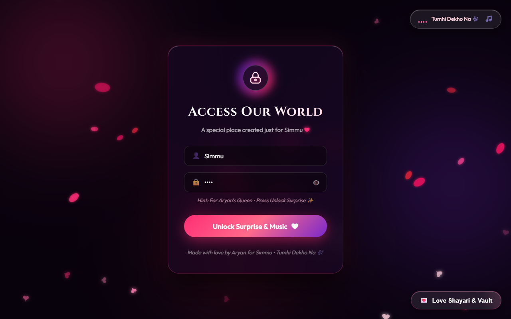

# Romantic Birthday Wish & Love Journey Webpage ❤

A glassmorphism-powered, interactive romantic birthday wish web application inspired by luxury glass UI, neon aesthetics, and scroll-driven storytelling.

---

## 📸 Interactive Web Experience Screenshot

<p align="center">
  
</p>

---

1. **Screen 1: Access Our World (Lock Screen)**
   - Glowing frosted glass card with animated padlock
   - Name and passcode input with eye toggle
   - Seamless unlock with chime and love sparkle effects

2. **Screen 2: Neon Birthday Greeting**
   - Glowing neon script typography & pulsing heart
   - Floating hearts and falling rose petals interactive canvas
   - Ambient romantic piano melody generator (via Web Audio API) with top-right equalizer toggle

3. **Screen 3: Our Precious Memories (Polaroids)**
   - 4 tilted Polaroid cards with heart pins and authentic paper tape
   - Click-to-enlarge modal with full captions and emotional notes
   - Ready for your personal photos

4. **Screen 4: Our Special Movie / Cinema Frame**
   - Frosted glass theater frame with ambient video backlight
   - Interactive play/pause scrubber and timestamp display

5. **Screen 5: Love Letter With Interactive Wax Seal**
   - Translucent glass envelope with a 3D wax seal
   - Click the wax seal to crack it open and unfold a letter with handwritten script

6. **Screen 6: Interactive Birthday Cake & Candle**
   - Multi-tiered chocolate-strawberry cake with glowing roses
   - Realistic flickering flame
   - Click candle or button to blow it out (plays realistic wind/breath audio effect + smoke animation)
   - "Cut The Cake!" action with fireworks confetti explosion

7. **Screen 7: The Grand Scroll Journey (Walking Hand-in-Hand)**
   - Unlocked after cutting the cake!
   - Illustrated couple walking together holding hands with animated step motion on scroll
   - Smoothly crossfading atmospheric scenes:
     - **Scene 1: Midnight Road** (Empty asphalt road under stars, glowing streetlights & greenery)
     - **Scene 2: Chandigarh Rose Garden** (Blooming rose arches under twilight fairy lights)
     - **Scene 3: Mountain Sunrise & World Adventure** (Foggy mountain peaks & golden sunrise)
     - **Scene 4: Candlelight Dinner & Adventure Proposal** (Intimate candlelit table, wine glasses, rose petals)
   - Interactive Proposal Buttons ("Yes, I'd Love To! 🥂" / "A Thousand Times YES! 💖")
   - Golden Date Reservation Ticket revealed upon acceptance!

8. **Hidden Surprises / Love Vault**
   - Floating button to open the secret Love Vault
   - 4 Redeemable Love Coupons (Midnight Ice Cream, Unlimited Hugs, Win Every Argument, Mountain Getaway)

---

## 📸 Replacing With Your Own Photos & Videos

When you are ready with your photos and video, simply replace the files in `assets/`:

- `assets/memory_smile.jpg` - Polaroid 1 (Our Smile)
- `assets/memory_favorite.jpg` - Polaroid 2 (Our Favorite Moment)
- `assets/memory_forever.jpg` - Polaroid 3 (Together Forever)
- `assets/memory_happy_place.jpg` - Polaroid 4 (My Happy Place)
- `assets/movie_poster.jpg` - Video frame poster (or replace with an `<video>` element)

---

## 🚀 Hosting on Vercel

To deploy to Vercel anytime:
```bash
vercel --prod
```
